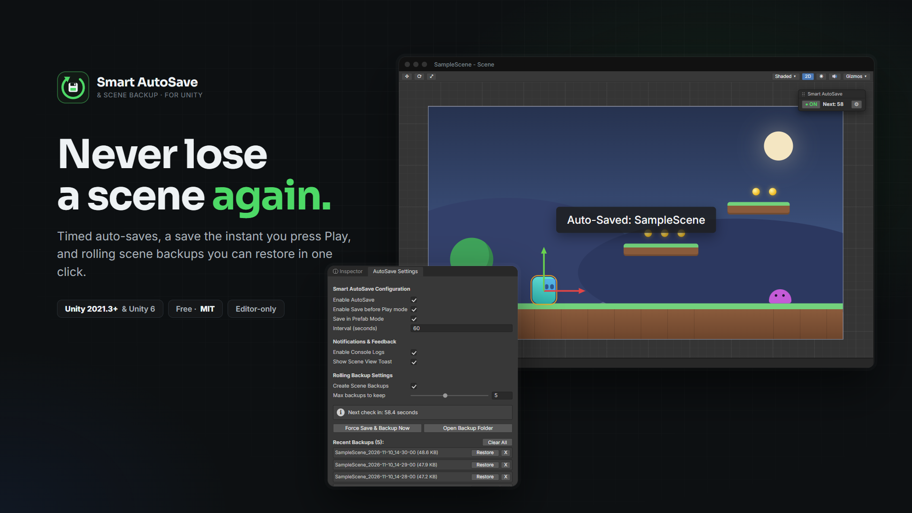
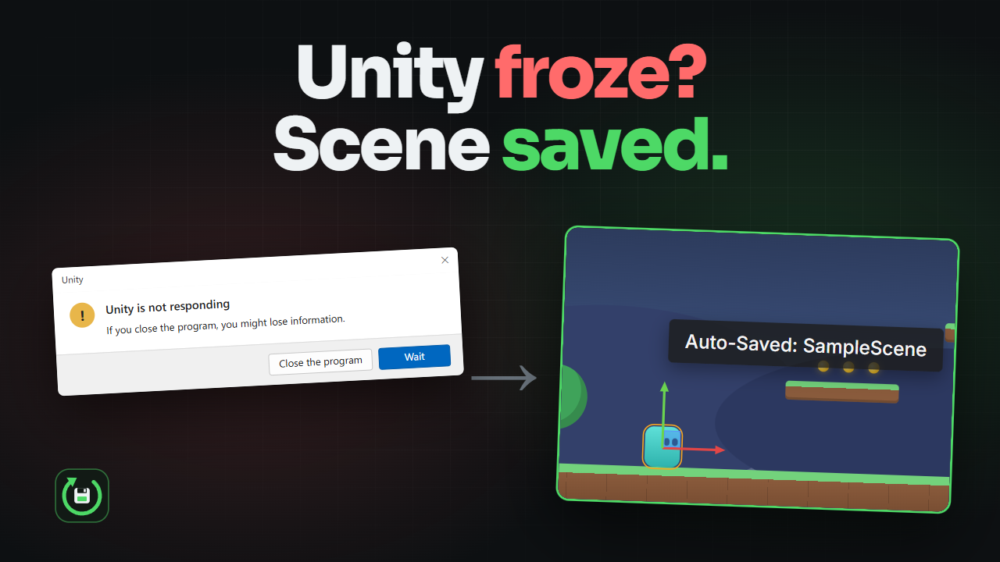
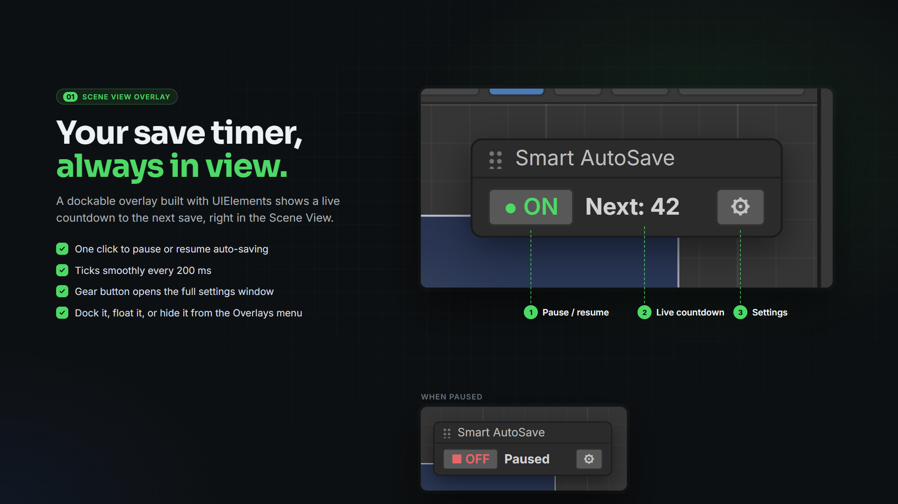
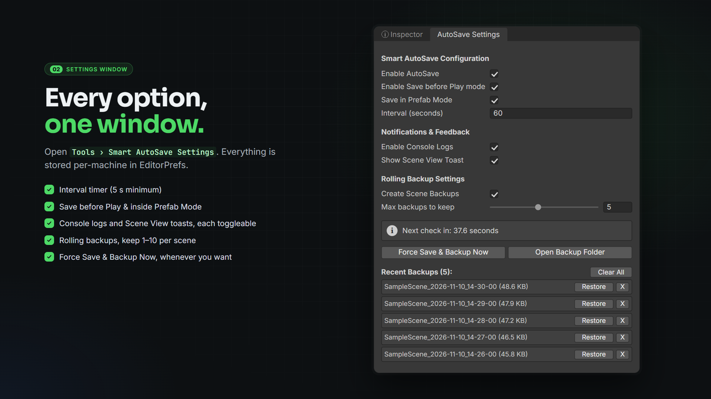
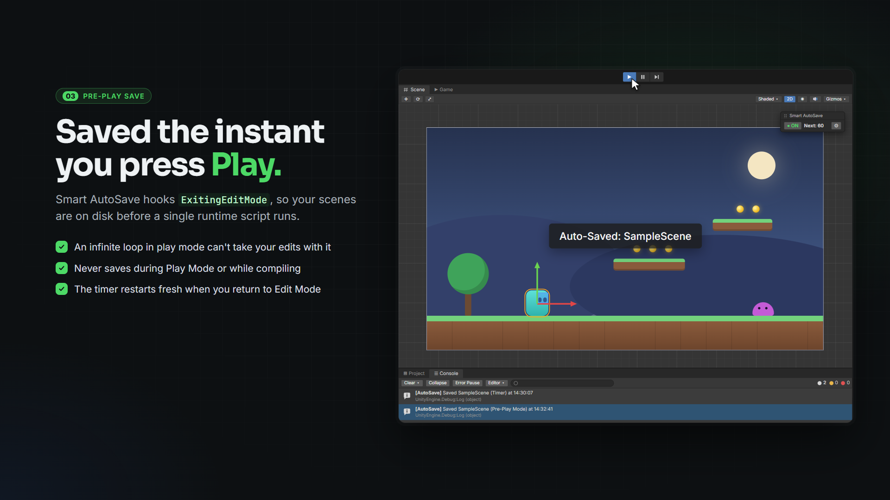
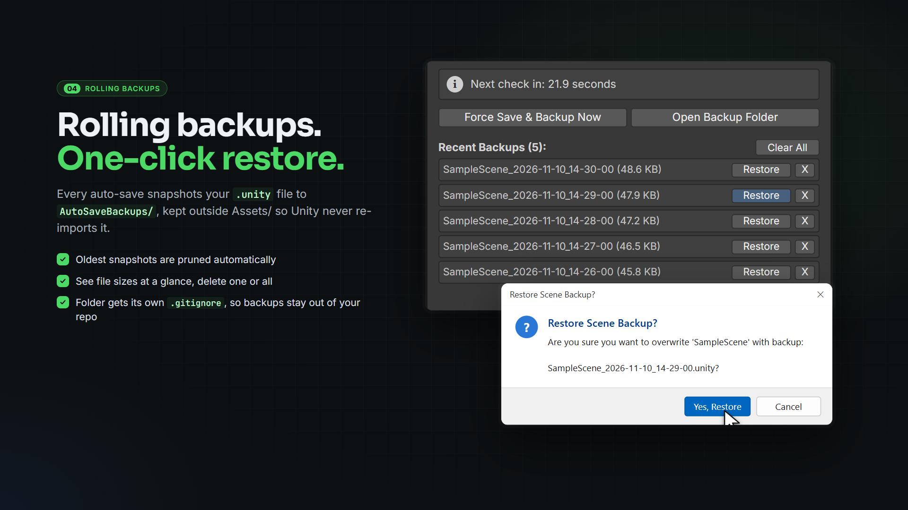
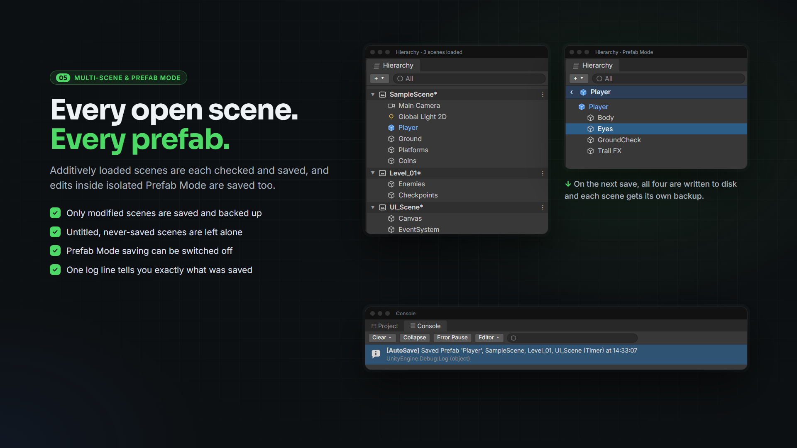
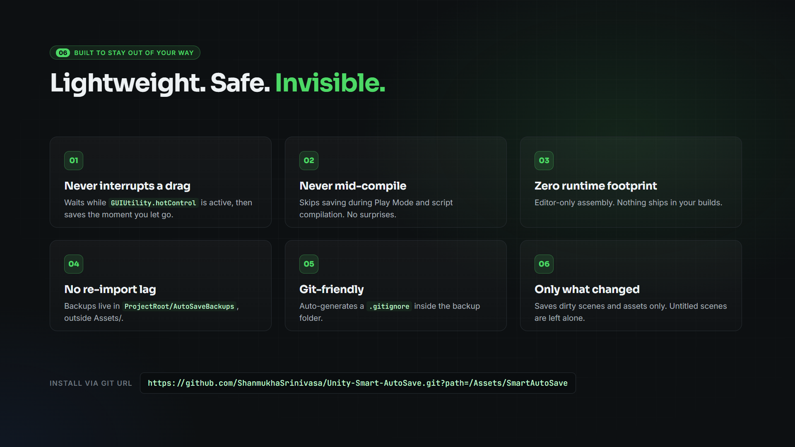

# Smart AutoSave & Scene Backup for Unity

A lightweight, non-destructive Auto-Save and Rolling Backup Editor extension for Unity (2021.3+ & Unity 6). Built to prevent lost work from Play Mode freezes, crashes, or accidental scene overwrites.

**[Download on itch.io](https://shanmukha.itch.io/smart-autosave)** · **[Watch the trailer](https://www.youtube.com/watch?v=gFy-Rloi064)** · Free & open source (MIT)

## Features
- **Configurable Interval Timer:** Automatically saves dirty scenes and assets in Edit Mode without interrupting active mouse drags (`GUIUtility.hotControl` guard).
- **Pre-Play Mode Save:** Automatically saves open scenes the instant you press **Play** (`PlayModeStateChange.ExitingEditMode`), before runtime scripts execute.
- **Isolated Prefab Mode Support:** Detects and saves modifications when editing inside Prefab Mode (`PrefabStageUtility`).
- **Multi-Scene Support:** Iterates across all loaded scenes in the Hierarchy and saves/backs up only modified scenes.
- **Non-Destructive Rolling Backups:** Snapshots `.unity` scene files into a Git-ignored `AutoSaveBackups/` folder with one-click restore and file-size inspection.
- **Scene View Overlay (`UIElements`):** Dockable toolbar pill showing live countdown status, quick pause/resume toggle, and settings shortcut.
- **Customizable Notifications:** Toggleable Console logs and unintrusive Scene View toast notifications (`SceneView.ShowNotification`).

## Screenshots

### Scene View overlay
Live countdown, one-click pause/resume, and a shortcut to the settings window.

### Settings window
Every option in one place: **Tools → Smart AutoSave Settings**.

### Pre-Play save
Your scenes are written to disk the instant you press Play.

### Rolling backups with one-click restore
Timestamped snapshots, oldest pruned automatically.

### Multi-scene & Prefab Mode
Every additively loaded scene, plus edits inside isolated Prefab Mode.

### Built to stay out of your way

## Installation

### Option 1: Install via Unity Package Manager (Git URL)
1. In Unity, open **Window -> Package Manager**.
2. Click the **`+`** button in the top-left corner -> **Add package from git URL...**
3. Paste:
   `https://github.com/ShanmukhaSrinivasa/Unity-Smart-AutoSave.git?path=/Assets/SmartAutoSave`

### Option 2: `.unitypackage` Release
Download the latest `.unitypackage` from the **Releases** page or [itch.io](https://shanmukha.itch.io/smart-autosave) and import it into your project.

## Usage
- Open **`Tools -> Smart AutoSave Settings`** from the top menu bar to configure intervals, toggle backups, or restore a previous scene snapshot.
- In the **Scene View**, press **`~`** (Overlays menu) and enable **Smart AutoSave** to dock the live countdown timer to your toolbar.

## License
MIT License — Copyright (c) Shanmukha Srinivasa. See [LICENSE](LICENSE).
